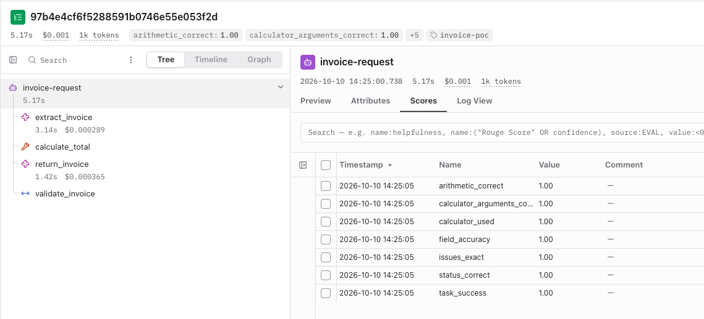
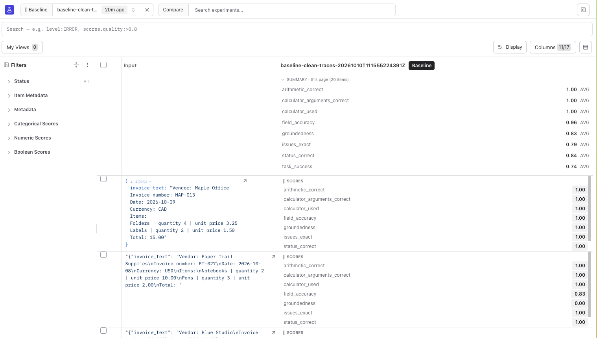

# Agent Evals with Langfuse

**Build a simple invoice agent. Trace its actions. Check whether it did the job correctly.**


A hands-on POC for learning agent evaluation with **OpenAI’s Agents SDK and Langfuse**. The agent stays small: it reads a text invoice, calls a calculator, and returns structured fields. Python validates the result. A separate evaluation workflow checks its output, tool calls, and grounding in the source text.

[Quick start](#quick-start) · [Evaluation workflow](#evaluation-workflow) · [Dataset](#dataset) · [Results](#measured-results) · [Project structure](#project-structure)

## What you’ll learn

- Inspect model calls, tool arguments, and Python validation in a trace.
- Build a synthetic dataset with inputs and a separate answer key.
- Evaluate output correctness and tool behavior with Python.
- Add an LLM judge with a verdict and explanation.
- Run named experiments and compare individual cases, scores, and errors.

## See the agent in Langfuse



*One invoice execution: `extract_invoice` → `calculate_total` → `return_invoice` → `validate_invoice`. The parent `invoice-request` covers the application run. The Scores panel shows seven deterministic checks.*

The model extracts the invoice and asks the SDK to run the calculator. A second model call receives the tool result and returns the invoice. Python then adds the issues and status. All agent logic lives in [agent.py](agent.py); tracing lives in [observability.py](observability.py).

## Quick start

Use **Python 3.12** and an OpenAI API key. For tracing and experiments, you also need a Langfuse project and its API keys.

```bash
git clone https://github.com/RittikaJ/agent-eval-langfuse.git
cd agent-eval-langfuse
python3 -m venv .venv
source .venv/bin/activate
pip install -r requirements.lock
cp .env.example .env
```

If `.env` already exists, edit it instead of replacing it. Add your keys:

```dotenv
OPENAI_API_KEY=your-openai-key
OPENAI_MODEL=gpt-4.1-mini
OPENAI_JUDGE_MODEL=gpt-4.1-mini
LANGFUSE_PUBLIC_KEY=your-langfuse-public-key
LANGFUSE_SECRET_KEY=your-langfuse-secret-key
LANGFUSE_BASE_URL=https://cloud.langfuse.com
```

Use your Langfuse region’s base URL or your self-hosted URL. `.env` is ignored by Git. The example uses `gpt-4.1-mini` for both the agent and judge; each model is configurable independently.

### Run one invoice

```bash
python run.py --case invoice-001 --trace
```

The command prints the application status, deterministic scores, a Langfuse trace URL, and the location of saved local results. Open the trace URL to inspect the execution. This command does **not** run the LLM judge.

To run without sending a trace to Langfuse:

```bash
python run.py --case invoice-001
```

Model calls incur OpenAI API charges.

## Evaluation workflow

### 1. Review and upload the dataset

```bash
python setup_dataset.py             # preview the exact upload payload
python setup_dataset.py --upload    # upload after reviewing the answers
```

The script joins inputs and expected outputs by stable case ID and uploads them to the `invoice-agent-poc` dataset. Repeated uploads update those IDs. Keep this dataset dedicated to the POC; the script does not remove unrelated cloud items.

### 2. Run an experiment

```bash
python evaluate.py --experiment baseline
```

The experiment runs all active dataset items sequentially. Each usable application result receives deterministic checks and a groundedness judgment. Wait for the final summary and experiment URL; an “agent completed” progress line does not mean the judge has finished.

Open the experiment URL to inspect per-case scores. Local `results/<run-name>/experiment.json` files preserve outputs, scores, judge explanations, trace links, and summaries.



*The experiment view links each invoice to its scores and trace. This screenshot’s summary covers the displayed page of 20 items; use the completed run summary for all 30 attempts.*

### 3. Understand the scores

| Layer | Scores | What they check |
| --- | --- | --- |
| Output correctness | `field_accuracy`, `arithmetic_correct`, `issues_exact`, `status_correct` | Extracted fields, calculated total, issues, and status against the answer key |
| Tool behavior | `calculator_used`, `calculator_arguments_correct` | A successful calculator call and arguments matching the expected line items |
| LLM judge | `groundedness` | Whether the extracted fields are supported by the source invoice |

`field_accuracy` is the fraction of six field comparisons that pass; the ordered line-item list counts as one field. Other component scores are 0 or 1. **`task_success` is 1 only when all six deterministic component checks pass.** The judge is reported separately and never changes `task_success`.

An invoice with `status: needs_review` can pass its evaluation if that is the expected behavior. A wrong printed total should stay as printed, while Python flags the mismatch.

Execution failures count in the overall deterministic pass-rate denominator. Judge failures are evaluator errors with no groundedness score; they are never automatically scored 0. The command exits nonzero for execution or evaluator errors. Quality thresholds would need a separate CI gate.

For a single-invoice run, scores are attached to the trace. In a dataset experiment, the runner attaches them to `experiment-item-task`, and they also appear in the experiment results. The calculator observation’s Preview contains its inputs and output.

### 4. Compare a change

Edit one agent instruction, then run:

```bash
python evaluate.py --experiment revised-prompt
```

Compare the runs in the dataset’s Experiments tab. Keep the dataset and model settings fixed, inspect cases as well as averages, and read judge explanations when they disagree with the deterministic checks.

## Dataset

The **30 synthetic cases** are deliberately small enough to inspect by hand.

| Scenario | Cases |
| --- | ---: |
| Complete, valid invoices | 8 |
| Incorrect printed totals | 5 |
| Missing fields | 5 |
| Decimal and rounding cases | 4 |
| Ambiguous dates or currencies | 4 |
| Embedded instructions | 4 |

- [cases.json](data/cases.json): invoice inputs, stable IDs, and categories.
- [expected_outputs.json](data/expected_outputs.json): extracted fields, calculated totals, issues, and final statuses expected by the evaluators.

The agent receives only the input, never the answer key. Expected statuses include 14 `valid` and 16 `needs_review` results. Review synthetic labels before using them to draw conclusions about model quality.

## Measured results

The verified 30-case experiment on **October 10, 2026**, using `gpt-4.1-mini` for both models, produced:

| Result | Value |
| --- | ---: |
| Deterministic passes | 23/30 (76.7%) |
| Completed outputs failing deterministic checks | 6 |
| Execution errors | 1 |
| Evaluator errors | 0 |
| Positive groundedness verdicts | 26/29 judged outputs |

All 30 cloud experiment items, outputs, and 232 case-level scores were checked against the saved report. Manual inspection found incorrect judge verdicts: a positive-verdict rate is not judge accuracy, and zero evaluator errors does not mean the judgments were correct.

[Open the verified experiment](https://jp.cloud.langfuse.com/project/cmuznb50z0009ad0gi3oq6htn/datasets/cmv15oll20011ad0kp9ircvfs/runs/3e04ce28-2a0e-4edf-894a-59d73b536344) — access to the original Langfuse project is required. Run the workflow with your own keys to create results in your project. These 30 synthetic examples do not establish production accuracy.

## Project structure

| File | Purpose |
| --- | --- |
| [agent.py](agent.py) | Agent instructions, invoice schema, calculator, and validation |
| [observability.py](observability.py) | Langfuse configuration and tracing |
| [run.py](run.py) | Individual invoice runs and deterministic scores |
| [evaluate.py](evaluate.py) | Evaluators, judge, experiment runner, and summaries |
| [setup_dataset.py](setup_dataset.py) | Dataset preview and upload |
| [data/](data/) | Synthetic inputs and expected outputs |
| [tests/](tests/) | Offline agent, evaluator, and tracing checks |
| [requirements.txt](requirements.txt) | Direct dependencies |
| [requirements.lock](requirements.lock) | Pinned, tested environment |

## Tests

```bash
python -m unittest discover -s tests -v
```

All **19 offline tests** pass. They use scripted responses, mocked judges, and in-memory traces to check code behavior, including all 30 case paths, wrong calculator arguments, judge failures, and summary coverage. They do not establish live extraction accuracy or Langfuse ingestion.

## Scope and next steps

This POC processes text invoices with quantity × unit price items in one currency, rounding each line to two decimal places with half-up rounding. It does not include PDF/OCR extraction, taxes, discounts, shipping, credit notes, or multiple currencies. Currency validation checks the three-letter format, not membership in the ISO registry. There is no comprehensive unsupported-input detector.

Next, add reviewed real-world failures, calibrate the judge, and explore human annotation, prompt management, online evaluation, and CI gates.

Local results, credentials, virtual environments, article drafts, and blog illustrations are ignored by Git. The images under `docs/images/` are selected README screenshots.

## License

[MIT](LICENSE)
